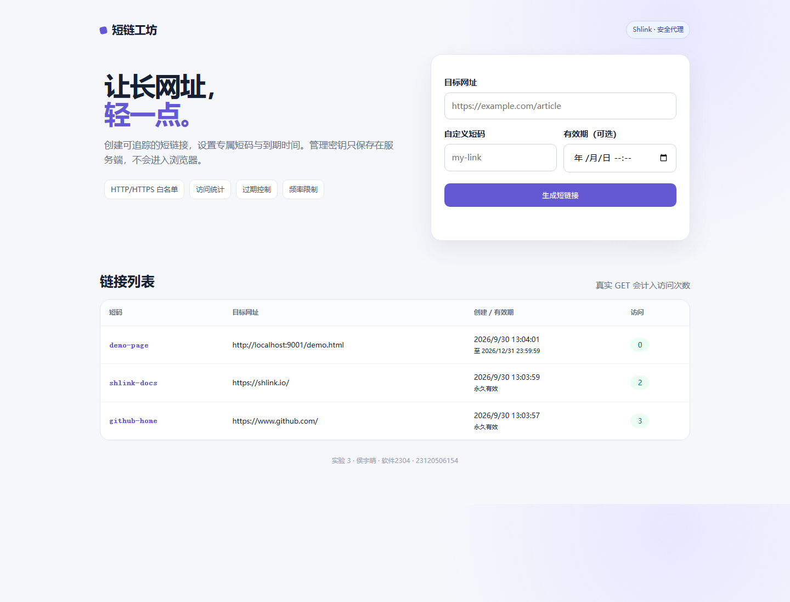
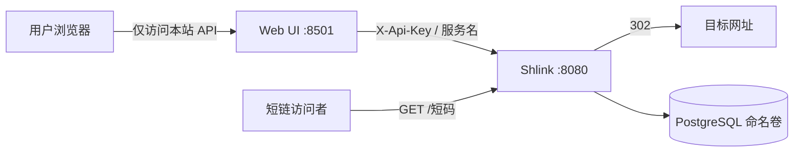

# 容器化短网址服务系统

基于 Shlink 5.1.6 的三服务短网址系统：输入长网址即可生成短链、完成跳转并查看访问次数。项目由侯宇晴（23120506154，软件2304）独立完成。



## 功能

- 创建 HTTP/HTTPS 短链，自动或自定义 4～30 位短码
- 通过 Shlink 302 跳转并统计真实 GET 访问
- 展示原网址、短码、创建时间、有效期和访问次数
- 自主扩展：自定义短码、到期时间、每 IP 创建频率限制
- 非法协议、超长 URL、短码冲突、未知及过期短码均有明确提示
- 管理密钥只由 Web 后端读取，浏览器不接触 `X-Api-Key`
- PostgreSQL 命名卷持久化，提供备份和恢复脚本
- 无 Docker 时可用 SQLite 演示模式完成主流程验证

## 技术栈与架构

- Shlink `5.1.6`：短码、重定向和访问记录
- PostgreSQL `16.14-alpine`：业务数据持久化
- Node.js `22.14.0-alpine3.21`：本人开发的管理界面和安全代理
- Docker Compose v2：网络、健康检查、启动依赖和命名卷



浏览器不持有 Shlink 密钥；Web 容器通过 Compose 服务名 `shlink:8080` 调用管理 API。短链访问者直接进入 Shlink，容器 IP 未被硬编码。

## 环境和版本检查

```powershell
git --version
docker version
docker compose version
node --version
```

建议 Git 2.40+、Docker Engine/Desktop 25+、Compose v2。仅运行自动化测试或本地演示需要 Node.js 22+。

## 容器方式启动

```powershell
Copy-Item .env.example .env
```

编辑 `.env`，将 `POSTGRES_PASSWORD` 和 `INITIAL_API_KEY` 替换为随机值。不要提交 `.env`，也不要把真实密钥截图到报告中。

```powershell
.\scripts\start.ps1
```

启动后访问：

- Web 管理页：<http://localhost:8501>
- Shlink 跳转入口：<http://localhost:8080>
- Shlink 健康检查：<http://localhost:8080/rest/health>

普通停止会保留卷：

```powershell
.\scripts\stop.ps1
```

> `docker compose down -v` 会永久删除本实验数据库卷。正常停止、验收和重建测试都不要使用 `-v`。

## 无 Docker 本地演示

```powershell
.\scripts\start-demo.ps1
```

访问 <http://localhost:8501>。演示数据保存在 `data/shortlinks.db`，该目录已被 Git 忽略。此模式用于在容器引擎不可用时验证本人开发的 UI、API、跳转、计数、有效期和持久化，不替代三容器验收。

离线目标页可另开终端运行：

```powershell
python -m http.server 9001 --bind 127.0.0.1 --directory demo-target
```

然后创建目标为 `http://localhost:9001/demo.html` 的短链。

## 最小 Demo 流程

1. 在 Web 页输入 `https://example.com/article`。
2. 自定义短码填写 `my-article`，有效期选未来时间，点击“生成短链接”。
3. 打开生成的短链 3 次，必须使用真实 GET，不用 HEAD 作为计数依据。
4. 回到管理页刷新，访问次数应为 3。
5. 创建相同短码，应收到冲突提示；输入 `javascript:alert(1)` 应被拒绝。
6. 执行 `docker compose down` 和 `docker compose up -d`，原短码和次数应仍存在。

## 测试

```powershell
npm test
docker compose config --quiet
docker compose up -d --build
docker compose ps
docker compose logs --tail 100 shlink web
```

2026-09-30 自动化结果：25 项全部通过。测试覆盖 API、Web、输入安全、统计和 SQLite 关闭重开后的持久化。详细命令、统计口径和容器验证边界见 [docs/TESTING.md](docs/TESTING.md)，接口表见 [docs/API.md](docs/API.md)。

## 备份和恢复

数据库运行时执行：

```powershell
.\scripts\backup.ps1
```

备份保存在被忽略的 `backups/`。恢复是覆盖性操作，需要人工输入 `RESTORE` 二次确认：

```powershell
.\scripts\restore.ps1 -BackupFile .\backups\shlink-日期时间.sql
```

## 二次开发说明

上游 Shlink 提供短链 API、跳转、有效期字段和访问记录；本仓库没有修改上游源码，而是固定官方镜像并增加独立 Web 服务。本人实现范围包括：

- 管理界面和服务端 Shlink 适配器
- HTTP/HTTPS 白名单、URL 长度及自定义短码校验
- 自定义短码冲突交互、有效期交互、创建频率限制
- 服务端 Key 隔离、请求超时和错误映射
- Web Dockerfile、三服务 Compose、健康依赖和命名卷
- 25 项自动化测试、一键启动停止及备份恢复脚本

## Git 开发证据

开发采用 `main` 基线和 `feature/shortlink-extension` 功能分支，提交分别覆盖编排基线、Web 主流程、测试、运维脚本和文档。对应 Issue 的验收条件为：创建、跳转、计数、自定义短码与到期时间、输入边界和持久化均可复核；PR 合并前按 [自我审查记录](docs/SELF_REVIEW.md) 检查。

```powershell
git log --oneline --graph --decorate --all -n 30
git shortlog -sne HEAD
```

## 安全说明

- `.env`、数据库、备份和日志均不进入 Git。
- 前端只请求本项目 `/api`，页面源码没有 `SHLINK_API_KEY` 或 `X-Api-Key`。
- 只允许 HTTP/HTTPS；生产部署还应增加域名信誉检查、HTTPS、反向代理和共享限流存储。
- 当前内存限流适合单 Web 实例；多副本部署应使用 Redis 等集中式存储。
- `AUTO_RESOLVE_TITLES=false` 避免 Shlink 主动访问用户提供的本地地址。

## 已知问题

- 本机 Docker Desktop Linux Engine 在测试时未运行，因此只完成 Compose 静态解析和本地功能测试，尚未记录真实三容器 `ps`、镜像摘要及卷删除重建截图。
- 本地 SQLite 演示模式使用 Node.js 实验性 `node:sqlite`，启动会显示实验性警告，不影响实验功能。
- Shlink 访问统计可能异步写入，容器模式下访问后应短暂等待再刷新。

## 开源来源

Shlink 5.1.6（MIT）、PostgreSQL 16.14（PostgreSQL License）、Docker Awesome Compose（CC0-1.0，结构参考）和 Node.js 22.14.0（MIT）。详细归因见 [NOTICE.md](NOTICE.md)。本仓库原创部分使用 [MIT License](LICENSE)。

